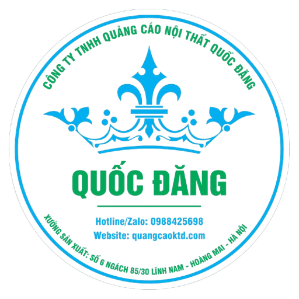

<div align="center">



# 📱 Quảng Cáo Quốc Đăng — Android App

**Ứng dụng Android chính thức của [quangcaoktd.com](https://quangcaoktd.com/)**
Công ty TNHH Quảng Cáo Nội Thất Quốc Đăng

[](#)
[-blue)](#)
[](#)
[](#)
[](#)
[](#)

</div>

---

## 📋 Mục lục

- [Giới thiệu](#-giới-thiệu)
- [Thông tin app](#ℹ️-thông-tin-app)
- [Tính năng nổi bật](#-tính-năng-nổi-bật)
- [Icon ứng dụng](#-icon-ứng-dụng)
- [Cấu trúc project](#-cấu-trúc-project)
- [Build & Chạy thử](#-build--chạy-thử)
- [Checklist trước khi đăng CH Play](#-checklist-trước-khi-đăng-ch-play)
- [Liên hệ](#-liên-hệ)

---

## 🏢 Giới thiệu

**Quảng Cáo Quốc Đăng** là ứng dụng Android dạng **WebView** đóng gói toàn bộ
website [quangcaoktd.com](https://quangcaoktd.com/), giúp khách hàng của
**Công ty TNHH Quảng Cáo Nội Thất Quốc Đăng** (Hà Nội) truy cập dịch vụ, xem
sản phẩm và gửi yêu cầu tư vấn – báo giá ngay trên điện thoại mà không cần mở
trình duyệt.

App được thiết kế tối giản, nhẹ, chỉ xin đúng một quyền `INTERNET`, tối ưu tốc
độ tải và xử lý điều hướng thông minh giữa nội dung trong app và các ứng dụng
bên ngoài (gọi điện, Zalo, Facebook, Google Maps...).

---

## ℹ️ Thông tin app

| Mục | Giá trị |
|---|---|
| 📦 Package / Application ID | `com.quangcaoktd.app` |
| 🏷️ Tên hiển thị | Quảng Cáo Quốc Đăng |
| 🌐 Trang chủ tải sẵn | [quangcaoktd.com](https://quangcaoktd.com/) |
| 📱 minSdkVersion | 21 (Android 5.0 trở lên) |
| 🎯 targetSdk / compileSdk | 36 |
| 🔢 versionCode / versionName | 1 / 1.0.0 |
| 🔐 Quyền yêu cầu | Chỉ **`INTERNET`** — không camera, không vị trí, không lưu trữ |
| ⚙️ Ngôn ngữ | Java |
| 🧰 Build system | Gradle 8.13 |

---

## ✨ Tính năng nổi bật

<table>
<tr>
<td width="50%" valign="top">

### 🖥️ WebView tối ưu
Bật JavaScript, DOM storage, zoom, cache để form **"Yêu cầu tư vấn – Báo
giá"** và toàn bộ nội dung site hoạt động mượt mà.

### 🌊 Header sóng riêng
`WavyHeaderView` tự vẽ dải màu `#0277A4` che vùng camera/loa/pin, viền dưới
bo sóng/giọt nước theo đúng mẫu thiết kế gốc.

### 🧭 Điều hướng thông minh
- Link cùng domain `quangcaoktd.com` (kể cả subdomain) → mở ngay trong app
- `tel:`, `sms:`, `mailto:`, Zalo, Facebook/Messenger, Google Maps,
  `target="_blank"` → tự mở app tương ứng đã cài trên máy (hoặc trình duyệt
  ngoài)
- Không có app phù hợp → hiện Toast báo lỗi thay vì crash

</td>
<td width="50%" valign="top">

### 🔒 Bảo mật
- Chỉ tải qua **HTTPS** — `network_security_config.xml` chặn cleartext, chỉ
  cho phép domain `quangcaoktd.com`
- Không bỏ qua lỗi chứng chỉ SSL (`onReceivedSslError` luôn `cancel()`),
  tránh lỗ hổng man-in-the-middle

### 📶 Trạng thái mạng
Thanh tiến trình khi tải trang, kéo để làm mới (pull-to-refresh), màn hình
**"Không có kết nối internet"** kèm nút **Thử lại** khi trang lỗi.

### ↩️ Điều hướng & khôi phục
- Nút Back quay lại trang trước trong WebView, thoát app nếu hết lịch sử
- Lưu/khôi phục trạng thái WebView khi xoay màn hình hoặc bị hệ thống thu
  hồi tạm thời

</td>
</tr>
</table>

---

## 🎨 Icon ứng dụng

Icon được tạo từ logo công ty, tự động resize cho mọi mật độ màn hình:

| Loại | Vị trí | Ghi chú |
|---|---|---|
| **Icon cũ (legacy)** | `mipmap-{mdpi,hdpi,xhdpi,xxhdpi,xxxhdpi}/ic_launcher.png` + `ic_launcher_round.png` | Dùng cho Android 7.1 trở xuống |
| **Adaptive icon** (Android 8+) | `mipmap-anydpi-v26/ic_launcher.xml` + `ic_launcher_foreground.png` | Logo thu về vùng an toàn ~62% khung 108dp, nền trắng `@color/ic_launcher_background`, không bị cắt dù launcher dùng mask tròn/vuông bo/squircle |
| **Icon cho Play Console** | `playstore-assets/play-store-icon-512.png` | 512×512px, nền trắng, không trong suốt — đúng chuẩn Google Play |

---

## 🗂 Cấu trúc project

```text
quangcaoktd-app/
├── app/
│   ├── build.gradle                     # applicationId, dependencies
│   └── src/main/
│       ├── AndroidManifest.xml          # chỉ khai báo quyền INTERNET
│       ├── java/com/quangcaoktd/app/
│       │   ├── MainActivity.java        # WebView + điều hướng + xử lý lỗi
│       │   └── WavyHeaderView.java      # header sóng màu #0277A4
│       └── res/
│           ├── layout/activity_main.xml # header + webview + progress + error view
│           ├── mipmap-*/                # icon các mật độ
│           ├── mipmap-anydpi-v26/       # adaptive icon
│           ├── values/                  # strings, colors, styles
│           ├── drawable/bg_retry_button.xml
│           └── xml/network_security_config.xml
├── playstore-assets/                    # icon 512×512 cho Play Console
├── build.gradle / settings.gradle / gradle.properties
└── gradle/wrapper/                      # Gradle 8.13
```

---

## 🚀 Build & Chạy thử

### Bằng Android Studio (khuyên dùng)

1. Mở thư mục project bằng **Android Studio** (bản mới nhất), chờ Gradle
   đồng bộ.
2. **APK debug** — cài thử trên điện thoại:
   `Build ▸ Build Bundle(s)/APK(s) ▸ Build APK(s)`
3. **AAB release** — để tải lên CH Play:
   `Build ▸ Generate Signed Bundle / APK` → chọn **Android App Bundle** →
   tạo/chọn keystore ký → chọn biến thể `release`.

### Bằng dòng lệnh (Gradle Wrapper có sẵn)

```bash
# APK debug
./gradlew assembleDebug

# AAB release (cần cấu hình signingConfig trong app/build.gradle
# hoặc dùng Android Studio để ký khi generate)
./gradlew bundleRelease
```

> ⚠️ **Lưu ý ký ứng dụng**: file build hiện chưa có `signingConfig` cho bản
> release. Khi build AAB để đăng Play Console, dùng **Generate Signed
> Bundle** của Android Studio để tạo keystore mới (hoặc dùng lại keystore cũ
> nếu là bản cập nhật của app đã phát hành) — Android Studio sẽ tự thêm cấu
> hình ký vào Gradle.

---

## ✅ Checklist trước khi đăng CH Play

- [ ] Tăng `versionCode` / `versionName` trong `app/build.gradle` mỗi lần cập nhật
- [ ] Chuẩn bị ảnh chụp màn hình app, mô tả ngắn/dài, banner theo yêu cầu Play
      Console (icon 512×512 đã có sẵn ở `playstore-assets/`)
- [ ] Điền **Privacy Policy URL** — vì app chỉ dùng WebView + quyền
      `INTERNET`, không thu thập dữ liệu thiết bị, có thể tham chiếu chính
      sách bảo mật hiện có trên quangcaoktd.com
- [ ] Khai báo mục **Data safety** trên Play Console: app không tự thu thập
      dữ liệu người dùng ngoài những gì website xử lý qua trình duyệt
      (cookie, form liên hệ)

---

## 📬 Liên hệ

<div align="center">

**Công ty TNHH Quảng Cáo Nội Thất Quốc Đăng**
📍 Hà Nội, Việt Nam · 🌐 [quangcaoktd.com](https://quangcaoktd.com/)

</div>

---

<div align="center">
<sub>© 2026 Quảng Cáo Quốc Đăng. Repo riêng tư cho mục đích phát triển nội bộ.</sub>
</div>
